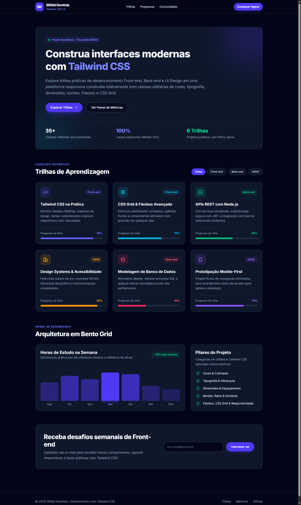
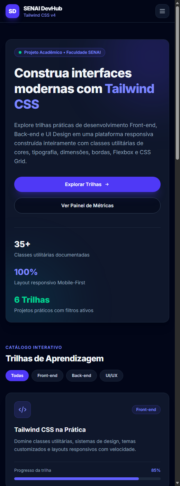
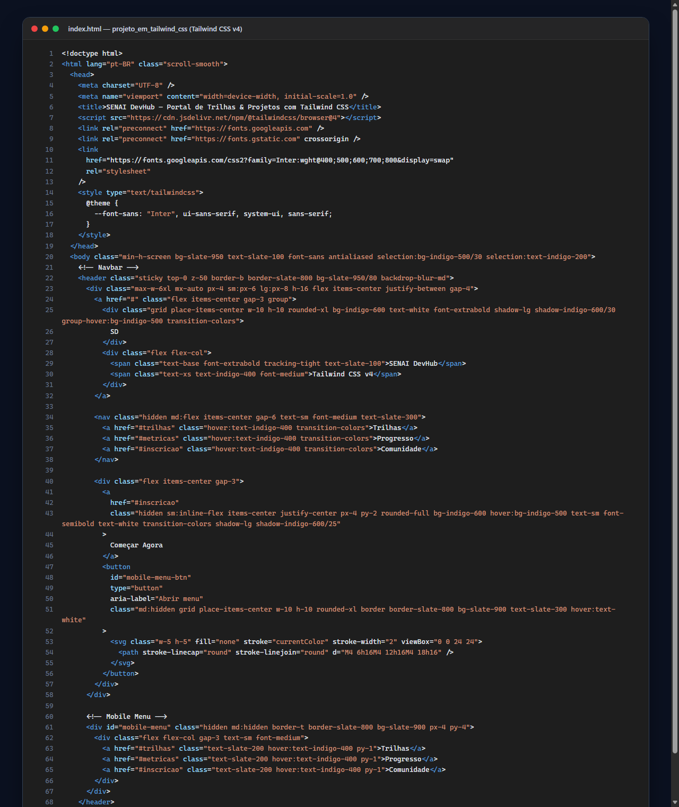

# SENAI DevHub — Aplicação com Tailwind CSS

Projeto acadêmico desenvolvido para a **Faculdade SENAI**, construindo uma interface web moderna e responsiva (**SENAI DevHub — Portal de Trilhas & Projetos Tech**) utilizando **Tailwind CSS v4** e mais de **30 classes utilitárias distintas** abrangendo cores, tipografia, dimensões, bordas, Flexbox, CSS Grid e responsividade.

---

## Link da Aplicação em Funcionamento

- **Aplicação online (GitHub Pages):** https://ahslammendes.github.io/projeto_em_tailwind_css/
- **Repositório GitHub:** https://github.com/ahslammendes/projeto_em_tailwind_css

---

## Funcionalidades Implementadas

- **Navegação fixa com efeito glassmorphism** (`sticky`, `backdrop-blur-md`) e menu colapsável para dispositivos móveis.
- **Seção Hero com indicadores** de destaque e chamadas para ação (CTAs) responsivas.
- **Catálogo interativo de trilhas** em grade responsiva (1 coluna no mobile, 2 no tablet, 3 no desktop) com **filtros por categoria** (Todas, Front-end, Back-end, UI/UX) e barras de progresso.
- **Painel em Bento Grid** exibindo gráfico de barras construído inteiramente com utilitários do Tailwind CSS e lista de pilares do projeto.
- **Formulário de inscrição** com validação e confirmação visual imediata.

---

## Prints da Aplicação e do Código-Fonte

### 1. Aplicação Executando — Desktop (`1440px`)



### 2. Aplicação Executando — Mobile Responsivo (`520px`)



### 3. Código-Fonte (`index.html`)



---

## Tabela de Classes Utilitárias Utilizadas (35 Classes)

Abaixo estão documentadas **35 classes utilitárias distintas** efetivamente utilizadas no arquivo [`index.html`](index.html), distribuídas entre todas as 7 categorias exigidas:

| # | Classe Utilitária | Categoria | Finalidade |
| :-: | :--- | :--- | :--- |
| 1 | `bg-slate-950` | **Cores** | Define a cor de fundo principal escura (slate 950) da página. |
| 2 | `bg-slate-900` | **Cores** | Aplica cor de fundo grafite-escuro nos cartões e superfícies elevadas. |
| 3 | `bg-indigo-600` | **Cores** | Define a cor de fundo índigo vibrante para botões primários e destaques. |
| 4 | `text-slate-100` | **Cores** | Define a cor clara principal dos textos para alto contraste sobre o fundo escuro. |
| 5 | `text-indigo-400` | **Cores** | Destaca palavras-chave, rótulos de seção e links em tom índigo claro. |
| 6 | `text-4xl` | **Tipografia** | Define tamanho de fonte grande (`2.25rem`) para o título principal da seção Hero. |
| 7 | `text-sm` | **Tipografia** | Define tamanho de fonte reduzido (`0.875rem`) para descrições, links e metadados. |
| 8 | `font-extrabold` | **Tipografia** | Aplica peso tipográfico extra negrito (`800`) aos títulos e marca do portal. |
| 9 | `tracking-tight` | **Tipografia** | Reduz levemente o espaçamento entre letras em títulos grandes para melhor legibilidade. |
| 10 | `leading-relaxed` | **Tipografia** | Aumenta a altura de linha (`1.625`) nos parágrafos para tornar a leitura mais confortável. |
| 11 | `min-h-screen` | **Dimensões** | Garante que o corpo da página ocupe no mínimo 100% da altura da viewport. |
| 12 | `max-w-6xl` | **Dimensões** | Limita a largura máxima do conteúdo principal (`72rem`) mantendo proporção equilibrada. |
| 13 | `w-full` | **Dimensões** | Faz o elemento ocupar 100% da largura disponível do seu container pai. |
| 14 | `p-6` | **Dimensões** | Aplica espaçamento interno uniforme (`1.5rem`) nos cartões e painéis. |
| 15 | `mx-auto` | **Dimensões** | Centraliza horizontalmente os containers principais utilizando margens automáticas. |
| 16 | `border` | **Bordas** | Adiciona borda sólida padrão de `1px` ao redor de cartões, botões e badges. |
| 17 | `border-slate-800` | **Bordas** | Define cor de borda sutil em tom grafite para delimitar superfícies e divisores. |
| 18 | `rounded-2xl` | **Bordas** | Aplica cantos amplamente arredondados (`1rem`) nos cartões e seções principais. |
| 19 | `rounded-full` | **Bordas** | Arredonda totalmente os cantos de botões pílula, badges e barras de progresso. |
| 20 | `shadow-xl` | **Bordas** | Adiciona sombra projetada pronunciada para criar profundidade visual nos cartões. |
| 21 | `flex` | **Flexbox** | Ativa o modelo de layout Flexbox no container. |
| 22 | `flex-col` | **Flexbox** | Organiza os itens flexíveis empilhados na direção vertical (coluna). |
| 23 | `items-center` | **Flexbox** | Alinha os elementos filhos ao centro no eixo transversal. |
| 24 | `justify-between` | **Flexbox** | Distribui os elementos nas extremidades com espaço igual entre eles (navbar, cards e footer). |
| 25 | `gap-4` | **Flexbox** | Define espaçamento consistente (`1rem`) entre elementos filhos flexíveis. |
| 26 | `grid` | **Grid** | Ativa o modelo de layout CSS Grid no container. |
| 27 | `grid-cols-1` | **Grid** | Define a grade com 1 coluna por padrão (estratégia mobile-first). |
| 28 | `gap-6` | **Grid** | Define espaçamento (`1.5rem`) entre linhas e colunas da grade de cartões e métricas. |
| 29 | `col-span-1` | **Grid** | Faz um item do grid ocupar exatamente 1 coluna no layout base. |
| 30 | `place-items-center` | **Grid** | Centraliza o conteúdo nos eixos horizontal e vertical dentro de containers de ícones em Grid. |
| 31 | `sm:flex-row` | **Responsividade** | Altera a direção do Flexbox para horizontal em telas a partir de `640px`. |
| 32 | `sm:text-5xl` | **Responsividade** | Aumenta o tamanho do título principal para `3rem` em telas `≥ 640px`. |
| 33 | `md:grid-cols-2` | **Responsividade** | Expande a grade de trilhas para 2 colunas em tablets e telas médias (`≥ 768px`). |
| 34 | `lg:grid-cols-3` | **Responsividade** | Expande a grade de trilhas e o Bento Grid para 3 colunas em desktops (`≥ 1024px`). |
| 35 | `lg:col-span-2` | **Responsividade** | Faz o gráfico semanal do Bento Grid ocupar 2 colunas em telas grandes (`≥ 1024px`). |

---

## Estrutura do Repositório

```text
projeto_em_tailwind_css/
├── index.html                  # Aplicação completa com Tailwind CSS v4 (Play CDN)
├── README.md                   # Documentação da entrega, prints e tabela de classes
└── docs/
    └── prints/
        ├── app-desktop.png     # Print da aplicação em execução (Desktop)
        ├── app-mobile.png      # Print da aplicação em execução (Mobile)
        └── codigo-fonte.png    # Print do código-fonte HTML + Tailwind CSS
```

---

## Como Executar Localmente

1. Clone o repositório:
   ```bash
   git clone https://github.com/ahslammendes/projeto_em_tailwind_css.git
   ```
2. Acesse a pasta do projeto e abra o arquivo `index.html` diretamente no navegador (ou utilize a extensão *Live Server* no VS Code).
